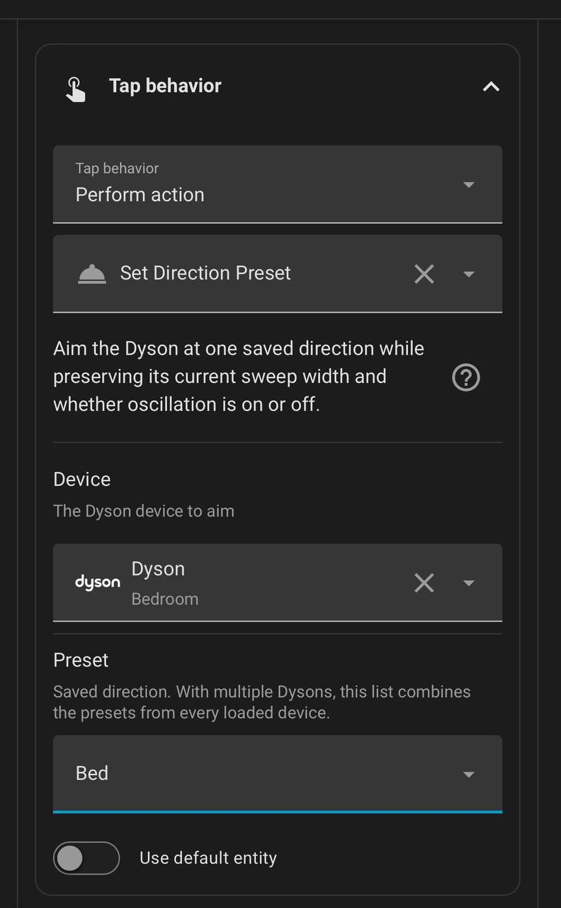

# HA Dyson Card

<p align="center">
  
</p>

[](https://github.com/thanhn062/ha-dyson-card/releases)
[](https://github.com/thanhn062/ha-dyson-card/releases)
[](https://github.com/thanhn062/ha-dyson-card/blob/main/LICENSE)
[](https://www.home-assistant.io/)
[](https://www.hacs.xyz/docs/use/repositories/dashboard/)
[](https://github.com/thanhn062/ha-dyson-card/actions/workflows/validate.yaml)
[](https://github.com/cmgrayb/hass-dyson)
[](https://github.com/mefengl/made-by-ai)
[](https://github.com/mefengl/made-by-ai)
[](https://www.buymeacoffee.com/thanhnatos)

> Check out my other Home Assistant related creations: [Maintenance Tracker](https://github.com/thanhn062/ha-maintenance-tracker)

A sleek Lovelace dashboard card for Dyson fans exposed through [`hass_dyson`](https://github.com/cmgrayb/hass-dyson).

[](https://my.home-assistant.io/redirect/hacs_repository/?owner=thanhn062&repository=ha-dyson-card&category=plugin)

I built this because I dislike having to open the Dyson app just to make the fan face a certain direction. This card brings that daily control flow into Home Assistant, next to the rest of the dashboard.

This is a frontend card only. It does not replace the Dyson integration; it uses the fan, climate, switch, select, number, and sensor entities already exposed in Home Assistant.

<p align="center">
  
</p>

## What's New

### Upcoming: Create script for saved directions

**Planned public feature — not included in v0.3.2.**

Save a position once, then use **Create script** to make your saved directions available to Home Assistant automations, NFC tags, buttons, and Stream Deck. The card stays frontend-only: the generated script uses Home Assistant's built-in script engine and your existing `hass_dyson` controls. No additional integration is required. Choose a sweep, or leave it at **None — preserve current**.

- Sit on the reading couch: a pressure pad triggers the **Reading couch** position with a 45° sweep.
- Sit on the bed: the bed pressure pad triggers **Bed**, keeping the current sweep.
- Scan a tag or press a Stream Deck button to recall the same saved positions.

See [Scripts and Automations](#scripts-and-automations) for the action fields, sweep options, and example workflows.

## Why This Card?

The default Home Assistant entity cards can control a Dyson device, but the experience is scattered across many entities.

HA Dyson Card pulls the useful pieces into one mobile-friendly control surface: direction aiming, sweep presets, airflow speed, power, auto/night mode, heat controls, filter life, and air-quality readings.

The goal is to make the Dyson feel like a polished Home Assistant appliance control instead of a collection of separate toggles and sensors.

## Highlights

- Fully functional Dyson control surface for the main things you would normally open the Dyson app to do
- Save preset directions with a name and icon, then tap once to aim the fan back there
- Mobile-first layout with direction, sweep, airflow, timer, sensor, filter, heat, and mode controls in one card
- Upcoming named-preset actions for scripts, NFC tags, pressure pads, and Stream Deck ([preview](#scripts-and-automations))

## Features

### Controls

- Direction wheel with drag-to-aim control
- Sweep dial presets for direct, 45°, 90°, 180°, and wide sweep
- Direction presets with custom name and MDI icon
- Inline airflow speed control with power button by default
- Auto mode, night mode, airflow direction, and sleep timer controls
- Heat, fan-only, and target temperature controls when a climate entity exists
- Optional left or right placement for the power and airflow speed controls

### Live Information

- Compact badges for temperature, humidity, AQI, and filter life
- Expandable air-quality details for AQI, PM2.5, PM10, VOC, and NO2
- AQI color coding when status/value can be mapped
- Same-device entity discovery from the selected Dyson fan entity
- Home Assistant theme-aware light and dark styling

### Direction Presets

Direction presets are for repeatable aiming positions such as `Bed`, `Desk`, or `Door`.

Each preset stores:

- name
- MDI icon
- center direction

Each preset chip displays its saved angle. Tapping it uses the existing Dyson angle controls, preserving the configured sweep width and oscillation state. The fan must be on to recall a saved direction.

Presets are saved in Home Assistant's per-user frontend storage and synchronized across that user's cards and browsers, with a local cache for temporary connection failures. You create your own preset names, icons, and angles in the card. No additional integration or helper is required.

Upcoming named-preset automation support is described in [Scripts and Automations](#scripts-and-automations).

## Requirements

- Home Assistant 2024.8.0 or newer
- [`hass_dyson`](https://github.com/cmgrayb/hass-dyson) installed and configured
- A Dyson `fan.` entity from `hass_dyson`
- Related Dyson entities attached to the same Home Assistant device for the best experience

## HACS Install

[](https://my.home-assistant.io/redirect/hacs_repository/?owner=thanhn062&repository=ha-dyson-card&category=plugin)

Or install it manually from the default HACS catalog:

1. HACS -> `Dashboard`
2. Search for `HA Dyson Card`
3. Install `HA Dyson Card`
4. Refresh or reopen Home Assistant so the dashboard resource is loaded

HACS installs dashboard cards under `www/community/` and serves them through `/hacsfiles/`.

## Quick Start

Add the card to a dashboard:

```yaml
type: custom:ha-dyson-card
entity: fan.my_dyson
```

Optional configuration:

```yaml
type: custom:ha-dyson-card
entity: fan.my_dyson
title: Bedroom Dyson
airflow_control_side: inline
```

## Configuration

| Option | Type | Default | Description |
| --- | --- | --- | --- |
| `entity` | string | required | Dyson `fan.` entity from `hass_dyson`. |
| `title` | string | empty | Optional card title. Empty titles do not render a header. |
| `airflow_control_side` | `inline`, `left`, or `right` | `inline` | Places power and fan speed in a horizontal panel below the wheel, or vertically on its left or right side. |
| `language` | string | auto | Optional UI language override (`en`, `de`, or `fr`). If omitted, the card follows the Home Assistant/frontend locale. |
| `hide_unsupported` | boolean | `false` | Hides controls and info chips that are unavailable on the selected device instead of showing them as disabled/empty. |
| `hide_empty_sensors` | boolean | `false` | Hides sensor badges with empty values (`unknown`, `unavailable`, or missing values). |
| `sensor_more_button_threshold` | number | `4` | Shows the More/Less sensor toggle only when the visible sensor item count is greater than this value. |
| `sensor_detail_layout` | `inline` or `panel` | `inline` | Forces where sensor details are rendered: inline in the top strip or in the details panel.

Example with both cleanup options enabled:

```yaml
type: custom:ha-dyson-card
entity: fan.purifier_cool_wohnung
title: Purifier Wohnung
airflow_control_side: right
language: de
hide_unsupported: true
hide_empty_sensors: true
sensor_more_button_threshold: 5
sensor_detail_layout: inline
```

## Control Mapping

| Control | Entity or service |
| --- | --- |
| Power | `fan.turn_on`, `fan.turn_off` |
| Auto | `fan.set_preset_mode` |
| Night | same-device night mode `switch.` |
| Airflow direction | `fan.set_direction` |
| Airflow speed | `fan.set_percentage` |
| Sleep timer | `hass_dyson.set_sleep_timer` |
| Direction wheel | `hass_dyson.set_oscillation_angles` or oscillation number entities |
| Sweep dial | oscillation select entity or angle services |
| Saved direction preset | Existing `hass_dyson.set_oscillation_angles` and `fan.oscillate` actions |
| Heat / Fan only | `climate.set_hvac_mode` |
| Target temperature | `climate.set_temperature` |

## Scripts and Automations

**Development preview — Create script is not included in v0.3.2.**

The planned workflow uses saved names instead of entering angle ranges in every automation:

1. Save a direction with a name such as **Reading couch** or **Bed**.
2. As an administrator, press **Create script** beneath the saved presets. This creates one reusable native script for this fan and HA user; it does not move the fan. Existing presets are imported automatically.
3. Use **Open script** to find the script, named **Your fan: Set Direction Preset**. Call it directly from an automation's action picker and select **Preset** and **Sweep**. Buttons, NFC automations, and Stream Deck can call the same script.
4. Set your own trigger in the automation: a pressure pad becoming occupied, an NFC scan, a schedule, or a button press.

Once created, the script runs inside Home Assistant with the dashboard closed. Adding or changing presets in the card updates the managed script automatically while an administrator is using it. The dropdown stores stable preset IDs, so existing calls continue to target the same saved position when its name changes. YAML and external callers can also pass the current saved name, such as `preset: Bed` (case-insensitive); name-based calls must be updated after a rename. Deleting a preset makes calls to that preset stop with an error; it does not silently redirect them to another position. Deleting all presets keeps the script present but prevents any recall.

Each HA user and fan gets a distinct script ID. This separates preset sets; it does not make scripts private from other HA administrators. Non-admin users cannot create or update these scripts. Configuration/API errors leave presets usable in the card and show a script-sync warning. **Update script** retries the update. Do not manually edit managed script steps: the card replaces those steps on the next preset update. User-created scripts with a conflicting ID are left untouched.

### Set Direction Preset options

| Option | Select | Default |
| --- | --- | --- |
| Script action | Your fan's generated **Set Direction Preset** script. | Choose the script for that fan |
| Preset | One of your saved direction names. | Required |
| Sweep | Keep the current setting, aim directly, or choose a sweep width. | **None — preserve current** |

| Sweep choice | Result |
| --- | --- |
| **None — preserve current** | Keep the current sweep width and oscillation on/off state. |
| **Direct / 0°** | Move to the saved direction, then stop oscillating. |
| **45°** | Start a 45° sweep around the saved direction. |
| **90°** | Start a 90° sweep around the saved direction. |
| **180°** | Start a 180° sweep around the saved direction. |
| **350°** | Start native 350° mode when the fan supports it; this full range cannot be centered on an arbitrary saved position. |

### Example workflows

| When | Preset | Sweep |
| --- | --- | --- |
| Reading-couch pressure pad becomes occupied | Reading couch | 45° |
| Bed pressure pad becomes occupied | Bed | None — preserve current |
| Bedside NFC tag is scanned | Bed | Direct / 0° |
| Stream Deck “Work” button is pressed | Desk | 90° |

For pressure pads, require occupancy for a few seconds to avoid repeated calls as someone shifts position. If two seats can be occupied at once, use automation conditions to decide which position takes priority.

The fan must already be on. Add a **Turn on** action before recalling the preset if your automation should also start the fan. Preset recall keeps the current fan speed.

<details>
<summary>Earlier named-preset picker reference</summary>

This earlier action screenshot illustrates the saved-name picker. The new generated script has its fan built in and provides Preset and Sweep fields; its current options are listed above. This is not a screenshot of the new script generator.

<p align="center">
  
</p>

</details>

Calls to the same generated script are queued to avoid overlapping movement commands. Separate users' scripts and other fan controls do not share that queue. Add priority conditions if multiple automations may control the same fan.

## Sensors

The default badge row shows the values most useful at a glance:

| Badge | Meaning |
| --- | --- |
| Temperature | Ambient temperature reported by the Dyson device. |
| Humidity | Ambient relative humidity. |
| AQI | Air Quality Index or category exposed by the integration. |
| Filter life | Lowest remaining HEPA/carbon percentage. Icon: amber at ≤20%, red at 0%; normal and unavailable readings stay neutral. |

The `More` section expands air-quality details when matching sensors exist:

| Detail | Meaning |
| --- | --- |
| AQI | Air Quality Index. Higher values or worse categories usually mean poorer air quality. |
| PM2.5 | Fine particulate matter around 2.5 microns. |
| PM10 | Larger particulate matter around 10 microns. |
| VOC | Volatile Organic Compounds from sources like cooking, cleaning products, smoke, or materials. |
| NO2 | Nitrogen dioxide, commonly associated with combustion sources. |

## Model Compatibility

The card adapts to the entities exposed by `hass_dyson`; it is not hard-coded to one Dyson model.

- Purifier-only models can use fan, speed, direction, sweep, sensor, filter, auto, and night controls when those entities exist.
- Heater models can also show heat, fan-only, and target temperature controls when a climate entity exists.
- Models without reverse airflow, heat, sleep timer, or specific air-quality sensors will have those controls hidden or disabled.

## Manual Install

Download `ha-dyson-card.js` and place it in:

```text
config/www/community/ha-dyson-card/ha-dyson-card.js
```

Then add this dashboard resource:

```text
/local/community/ha-dyson-card/ha-dyson-card.js
```

Resource type:

```text
JavaScript module
```

## Troubleshooting

### The card does not appear in the card picker

Refresh or reopen Home Assistant after installing the dashboard resource. If it still does not appear, use a Manual card with `type: custom:ha-dyson-card`.

### HACS installed it, but the browser still shows an old version

Hard refresh the Home Assistant frontend. If you manually edited the file under `www/community`, remove the generated `.gz` copy so Home Assistant serves the updated JavaScript.

### Controls are missing

Check that the missing feature is exposed by `hass_dyson` as an entity or supported fan/climate feature. The card hides or disables controls that cannot be safely mapped.

### Direction or sweep behaves differently than expected

Dyson models and `hass_dyson` entity sets vary. The card prefers same-device oscillation select/number entities when available and falls back to `hass_dyson.set_oscillation_angles` for angle commands.

## Development

Run the syntax check locally:

```bash
node --check ha-dyson-card.js
```

The GitHub workflow runs:

- HACS plugin validation
- JavaScript syntax validation on Node 24

## Credits

- Built for [`hass_dyson`](https://github.com/cmgrayb/hass-dyson)
- Distributed as a HACS Dashboard/plugin repository

## Disclaimer

This project was built with Codex, with me serving as project manager and overseeing the direction, review, and iteration process throughout.

## License

Apache-2.0
